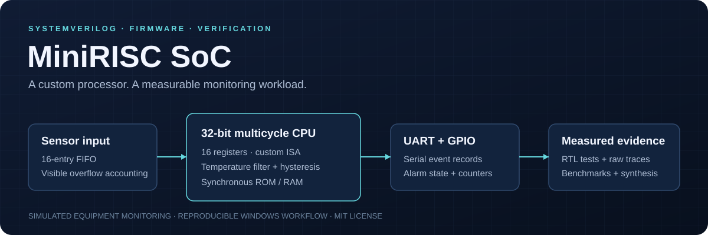
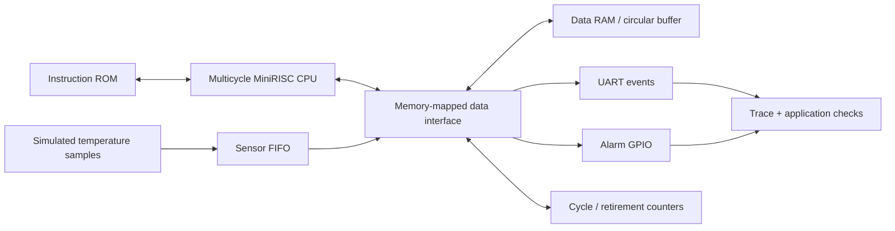

# MiniRISC SoC



[](https://github.com/PahuldeepSinghSodhi/mini-risc-soc/actions/workflows/verify.yml)
[](LICENSE)


A custom 32-bit processor that runs temperature-monitoring firmware in RTL simulation. The project connects instruction execution, memory-mapped devices, software filtering, serial event reporting, and reproducible verification.

```text
Simulated equipment readings → 16-entry sensor FIFO → MiniRISC firmware
                            → 16-sample rolling average → GPIO alarm + UART events
                            → independent Python checks + cycle-level measurements
```

The CPU has sixteen registers and a custom word-addressed instruction set. It is **not RISC-V compatible**. This release is a software-simulated and generically synthesized hardware design; no FPGA, physical sensor, or laptop hardware connection is required.

**Explore:** [Architecture and ISA](PROJECT_WALKTHROUGH.md) · [Design decisions](docs/DESIGN_DECISIONS.md) · [Verification](docs/VERIFICATION.md) · [Measured results](reports/RESULTS.md)

## Reference results

| Evidence | Measured reference result |
|---|---|
| Regression | **46 passing cases/suites**, including 5,000 randomized FIFO cycles |
| End-to-end demo | **512 processed samples, zero drops, two expected alarm transitions** |
| Input-rate sweep | **128 cycles** is the smallest tested zero-drop interval |
| Alarm response | **89 / 93 cycles** from the qualifying sample's arrival to GPIO change |
| Generic synthesis | CPU: **4,021** primitives; complete SoC: **24,114** primitives |

These are the committed [reference measurements](reports/RESULTS.md), with source/firmware fingerprints and raw inputs. They describe simulated cycles and technology-independent synthesis, with the experiment boundaries documented alongside the results.

## Architecture



## Run it

Tested on Windows x64 with Python 3.14 and Visual Studio C++ tools. The runner uses CMake/Ninja and MSVC, without changing the global PATH. If the Windows SDK is missing, setup downloads pinned Microsoft SDK NuGet packages into the local build directory.

Clone the repository, then run:

```powershell
git clone https://github.com/PahuldeepSinghSodhi/mini-risc-soc.git
cd mini-risc-soc
python tools/run.py setup
python tools/run.py all
```

After setup, `all` builds the firmware and native RTL simulators, runs the regression and demo, benchmarks the workload, and synthesizes the core and SoC. Any failed command, assertion, mismatch, or synthesis check fails the workflow.

Individual commands are `test`, `demo`, `benchmark`, and `synth`. Each rebuilds changed sources before running. Packages are pinned in [requirements-tools.txt](requirements-tools.txt). Setup requires network access once; regular runs use the installed tools.

## What is implemented

- A multicycle CPU with fetch, execute, memory-wait, and stopped states; independent instruction/data request-completion interfaces; retained HALT and fault reporting.
- The existing arithmetic, decoder, control, immediate, and register-file components integrated into a working datapath. R0 is protected; store/branch operands are normalized; illegal instructions cannot silently write results.
- 256-word instruction ROM and 256-word data RAM, with synchronous responses and full-address bounds checks.
- A sensor FIFO, UART RX/TX with independent FIFOs, cycle/retirement counters, and GPIO, accessible through ordinary load/store instructions.
- A 59-instruction firmware image implementing a circular buffer, rolling sum, warm-up, averaging, hysteresis, and four-byte serial alarm records.
- Directed CPU/device tests, randomized FIFO testing, delayed-response checks, MMIO integration tests, and application results checked against an independent Python algorithm.

## The application

Input values are unsigned tenths of a degree Celsius, carried on a simulated 12-bit sample interface. The application is an illustrative equipment-monitoring workload.

Firmware clears its ring buffer and statistics, then raises GPIO bit 1 to indicate readiness. It polls for samples and computes the integer average of the latest sixteen readings. During warm-up, unused window entries contribute zero, but alarms are suppressed until sixteen readings have been processed.

- Alarm turns **on at an average ≥80.0°C**.
- Alarm turns **off at an average ≤75.0°C**.
- Between those thresholds, its previous state is retained.
- GPIO bit 0 carries the alarm state.
- Each transition emits UART bytes `[0xA5, state, average_low, average_high]`, with the average in tenths of a degree, little-endian.

The deterministic demonstration includes normal readings, one isolated spike, sustained overheating, threshold noise, and recovery. Overload tests intentionally drive samples faster than firmware can consume them; full input FIFOs discard the newest arrival and count it.

## Results and evidence

Read [reports/RESULTS.md](reports/RESULTS.md) for the measured results from the current implementation. The report includes the implementation fingerprint and firmware hash. Its evidence is regenerated by `all`:

| Output | Contents |
|---|---|
| `reports/tests.json` | CPU/component suite counts, MMIO cases, application checks |
| `reports/demo.json` | Demonstration outputs, event temperatures, filter and processing latency |
| `reports/benchmark.json` | Fixed 512-sample workload, interval sweep, losses, queueing and processing cycles |
| `reports/synthesis.json` | Core/SoC primitive counts, sequential cells, memory shapes before mapping |
| `reports/raw/` | Input samples, CSV observations, per-run JSON |
| `reports/toolchain.json` | Actual binary identification, package/compiler versions, SDK hashes |
| `build/firmware.lst` | Generated instruction addresses, encodings, and readable listing |

The benchmark reports the **smallest tested zero-drop interval**, not a proven universal throughput limit. Processing cycles are measured from the hardware FIFO pop to the firmware's processed-count RAM write. Alarm latency starts at the accepted qualifying sample's arrival; filtering delay is reported separately.

Synthesis uses Slang and Yosys with `-noabc`. Counts are technology-independent primitives with memories expanded into generic storage/logic. They are **not FPGA LUT/BRAM utilization, physical area, maximum frequency, or power measurements**. Simulation debug ports and assertions are excluded from synthesis.

Reports are fingerprinted against the source and firmware. Running only one stage after changing code does not produce a combined report using incompatible earlier results; rerun `all` to regenerate the complete evidence.

GitHub Actions runs that same workflow on a fresh Windows runner for pushes and pull requests. Its artifact contains regenerated reports, raw traces, build diagnostics, and the firmware hex/listing; the workflow badge links to its current status.

## Design reference

See [PROJECT_WALKTHROUGH.md](PROJECT_WALKTHROUGH.md) for the ISA, bus contract, memory map, firmware registers, and file-by-file explanation. The [original review](docs/ORIGINAL_REVIEW.md) is preserved as historical context; its missing-component findings describe the starting point, not this release.

Known boundaries: one outstanding transaction per port, no interrupts/caches/pipeline, polling firmware, unsigned temperature input, a fixed sixteen-sample window, cycle-based simulation timing, and no formal correctness proof or physical deployment. A permanently unresponsive external bus can stall the CPU indefinitely; simulation watchdogs catch this during testing. A full assembler and instruction-set reference interpreter are not included.

## Contributing and license

See [CONTRIBUTING.md](CONTRIBUTING.md) for the development workflow and [CHANGELOG.md](CHANGELOG.md) for the initial release. Source is available under the [MIT license](LICENSE).
