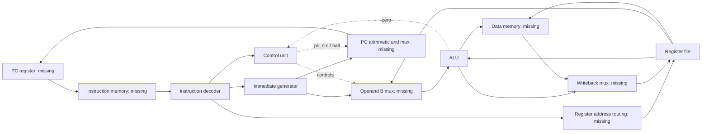

> Historical review of the six-file starting point. For the current integrated project, see ../README.md and ../PROJECT_WALKTHROUGH.md. Line references below refer to the original source.

# MiniRISC: code-grounded project walkthrough

Reviewed against all six source files in `rtl/` on 14 October 2026. This guide describes the current source; it distinguishes existing behavior from a proposed integration.

## 1. What this project currently is

This is a collection of SystemVerilog components for a custom 32-bit RISC processor. The package describes a word-addressed, single-cycle architecture with 16 registers. The folder does **not yet contain an integrated, executable CPU**.

The current files are:

| File | Responsibility | State |
|---|---|---|
| [mini_risc_pkg.sv](../rtl/mini_risc_pkg.sv) | Shared constants, instruction codes, operation codes, signal types | Definitions only |
| [instruction_decoder.sv](../rtl/instruction_decoder.sv) | Split an instruction into fields and identify its format | Combinational |
| [immediate_generator.sv](../rtl/immediate_generator.sv) | Construct a 32-bit immediate | Combinational |
| [control_unit.sv](../rtl/control_unit.sv) | Generate operation, memory, writeback, and PC selection controls | Combinational |
| [alu.sv](../rtl/alu.sv) | Calculate results and flags | Combinational |
| [register_file.sv](../rtl/register_file.sv) | Hold the register values | Sequential writes/reset; combinational reads |

There is no CPU top module, program-counter register, instruction memory, data memory, datapath mux wiring, assembler, program image, testbench, build script, or FPGA configuration in this folder. Memory capacities are constants, not instantiated memories. The folder is also not a Git repository.

This is a **custom instruction set**, not a RISC-V implementation. Familiar instruction names do not make its binary encoding compatible with RISC-V or MIPS.

## 2. Why the modules are separated

An instruction must answer several different questions: what operation is requested, which register values are needed, what constant is embedded, where the result should go, and which instruction should execute next. Each module handles one of those jobs.

The following diagram shows the intended connections. Everything labeled missing must still be implemented or wired by a top module.



SystemVerilog describes hardware operating concurrently. These modules are not ordinary functions called one after another. Combinational signals settle as their inputs change; the register file commits a write at a rising clock edge.

## 3. Package: the shared contract

Read `mini_risc_pkg.sv` first:

- Lines 15–21 declare 32-bit data, 16 registers, 4-bit register addresses, and separate intended instruction/data memories of 256 words each. At 32 bits per word, each memory would hold 1 KiB.
- Lines 26–39 assign 4-bit opcodes. Values `B` through `E` are undefined.
- Lines 44–53 assign eight R-type function codes.
- Lines 58–68 define nine internal ALU operations. Codes `0` through `7` deliberately match the R-type functions; code `8` passes operand B through.
- Lines 73–78 define writeback selection: ALU result, memory result, return address, or reserved immediate source.
- Lines 83–90 define instruction-format labels. These labels do not change the raw field extraction by themselves.

The source names the return-address selection `WB_PC4`, but its package comment says **PC + 1**. Other files say PC + 4. That inconsistency must be resolved before integration.

Although widths are declared as parameters, this implementation is effectively specialized for 32-bit instructions/data and 16 registers: the decoder uses fixed instruction slices, immediate extension uses fixed replication counts, and shifts use five bits. Changing one parameter alone does not create a correct different-width CPU.

## 4. Decoder: from a word to fields

`instruction_decoder.sv:31` through `:37` continuously extract:

```text
opcode = instr[31:28]
rd     = instr[27:24]
rs1    = instr[23:20]
rs2    = instr[19:16]
funct  = instr[3:0]
imm20  = instr[19:0]
imm24  = instr[23:0]
```

The casts convert bit fields to the declared enum types; they do not check that a value belongs to a named enum member.

The same bits mean different things in different formats:

| Format | Bits 31:28 | Bits 27:24 | Bits 23:20 | Remaining bits |
|---|---|---|---|---|
| R | opcode 0 | destination | source 1 | source 2 at 19:16; reserved 15:4; function 3:0 |
| I | operation | destination | source 1 | signed immediate 19:0 |
| S | opcode 5 | **store source 2** | base/source 1 | immediate 19:0 |
| B | opcode 6 or 7 | **comparison source 2** | source 1 | offset 19:0 |
| J | opcode 8 | link destination | part of offset | full offset 23:0 |

Lines 40–50 label the format. LUI is classified as I-type, though its source-1 field is not needed for the operation. HALT has its own format.

**Critical integration detail:** the output called `rs2` always contains bits 19:16. For stores and branches, the actual second register is in bits 27:24, exposed by the output called `rd`. A top module must select the correct read-port-2 address, or the decoder must be changed to normalize it.

For example, `SW R3,2(R1)` encodes as `0x53100002`. This decoder produces `rd=3`, `rs1=1`, and `rs2=0`. Connecting `decoder.rs2` directly to register read port 2 would select R0 instead of the intended R3.

The decoder does not validate reserved R-type bits or illegal function codes. Undefined opcodes receive `FMT_HALT`, but that label alone does not assert the controller's `halt` output.

## 5. Immediate generator: widening embedded constants

`immediate_generator.sv:24` through `:29` implements three cases:

| Instruction | Expression | Meaning |
|---|---|---|
| LUI | `{imm20, 12'b0}` | Put the immediate in the upper 20 bits |
| JAL | `{{8{imm24[23]}}, imm24}` | Sign-extend a 24-bit offset to 32 bits |
| All others | `{{12{imm20[19]}}, imm20}` | Sign-extend a 20-bit immediate to 32 bits |

Concatenation joins bit fields. Replication repeats a bit. Copying the sign bit into the upper bits preserves the value of a two's-complement negative number.

Examples:

- `imm20=0x00005` becomes `0x00000005`, or +5.
- `imm20=0xFFFFF` becomes `0xFFFFFFFF`, or −1.
- LUI with `imm20=0xABCDE` produces `0xABCDE000`.
- JAL with `imm24=0xFFFFFE` produces `0xFFFFFFFE`, or −2.

The signed 20-bit range is −524,288 through +524,287; the signed 24-bit range is −8,388,608 through +8,388,607. Actual reachable addresses will also depend on the missing PC/memory implementation.

ANDI and ORI also receive **sign-extended** immediates. That is the behavior of this custom design. For instance, an immediate of `0xFFFFF` supplies a full 32-bit all-ones mask to ANDI.

Offsets are documented as word offsets and are not shifted left by two. This module only produces an offset; it does not add it to a PC or define the precise target equation.

## 6. Register file: the state currently implemented

`register_file.sv:35` declares 16 × 32 bits of register storage, totaling 512 declared bits.

- Lines 38–39 provide two asynchronous reads. Changing a read address changes the corresponding output after combinational propagation.
- Line 42 defines rising-edge writes and an asynchronous active-low reset.
- Lines 43–45 clear every register when reset is asserted. Reset has priority over writing.
- Lines 46–47 update one register when `wen=1` and the destination is not R0.
- Line 52 exposes the entire array through `regs_out` for observation.

The `<=` assignments are nonblocking: state updates are scheduled together at the clock event. There is no explicit read-during-write bypass; an asynchronous read of the written register reflects the new stored value after that update.

R0 remains zero **after reset**, because writes to it are discarded. The reads do not independently force R0 to zero, so reset must occur before relying on initialized values in simulation. The source does not define power-up values without reset.

Only this module stores changing architectural state today. There is no existing PC state, memory state, or latched halted state elsewhere in the folder.

## 7. ALU: operations and flags

`alu.sv:28` and `:29` compute addition and subtraction continuously. The case statement at lines 41–64 selects the requested result.

| Code | Operation | Behavior |
|---|---|---|
| 0 | ADD | 32-bit addition, wrapping modulo 2³² |
| 1 | SUB | 32-bit subtraction, wrapping modulo 2³² |
| 2 | AND | Bitwise AND |
| 3 | OR | Bitwise OR |
| 4 | XOR | Bitwise XOR |
| 5 | SLT | Signed comparison; result is 0 or 1 |
| 6 | SLL | Logical left shift by `operand_b[4:0]` |
| 7 | SRL | Logical right shift by `operand_b[4:0]` |
| 8 | PASS_B | Return operand B, used for LUI |

The shift amount ranges from 0 to 31. Higher bits of operand B are ignored; a value of 32 therefore selects a shift of zero. SRL fills with zeros, including for values whose top bit is set. There is no arithmetic-right-shift operation.

`$signed` in SLT makes both operands signed for that comparison. For example, `0xFFFFFFFF` is −1 and compares less than +1. The other bitwise/shift operations do not inherit that signed interpretation.

Flags are live combinational outputs:

- `zero`: the selected result is zero.
- `negative`: the selected result's top bit is one.
- `overflow`: signed overflow for ADD or SUB; zero for the other operations.

Addition overflows when the operand signs match and the result sign differs. Subtraction overflows when the operand signs differ and the result sign differs from operand A. Thus `0x7FFFFFFF + 1` gives `0x80000000` with overflow asserted. Carry-out and signed overflow are different concepts; there is no carry flag here.

There is no saturation, exception, or overflow trap. Flags are not stored in a status register. Unknown operation codes fall through to a zero result, with overflow zero; the zero flag then asserts.

## 8. Controller: turning the instruction into datapath choices

`control_unit.sv:25` starts a combinational block. Lines 27–34 assign defaults to every output, so unused branches do not require the outputs to remember old values or infer latches.

Defaults are: no register write, no memory read/write, register operand B, ADD operation, ALU writeback, sequential PC selection, and halt deasserted.

The following table lists the resulting control behavior. `Z` means the ALU zero flag supplied to the input named `branch_taken`.

| Instruction | Register write | Memory read | Memory write | B operand | ALU | Writeback | Target PC selected |
|---|---:|---:|---:|---|---|---|---|
| R-type | 1 | 0 | 0 | register | cast from funct | ALU | 0 |
| ADDI | 1 | 0 | 0 | immediate | ADD | ALU | 0 |
| ANDI | 1 | 0 | 0 | immediate | AND | ALU | 0 |
| ORI | 1 | 0 | 0 | immediate | OR | ALU | 0 |
| LW | 1 | 1 | 0 | immediate | ADD | memory | 0 |
| SW | 0 | 0 | 1 | immediate | ADD | unused | 0 |
| BEQ | 0 | 0 | 0 | register | SUB | unused | Z |
| BNE | 0 | 0 | 0 | register | SUB | unused | !Z |
| JAL | 1 | 0 | 0 | register/default | ADD/default, unused | return address | 1 |
| LUI | 1 | 0 | 0 | immediate | PASS_B | ALU | 0 |
| SLTI | 1 | 0 | 0 | immediate | SLT | ALU | 0 |
| HALT | 0 | 0 | 0 | register/default | ADD/default, unused | unused | 0 |

HALT alone sets `halt=1`. Undefined opcodes leave every output at its default, including `halt=0`.

For R-type instructions, `alu_op_t'(funct)` works because function codes and ALU operation codes match numerically. It is a representation conversion, not a lookup or legality check.

For loads and stores, the ALU calculates `base register + immediate`. A store still needs the original second register value wired separately to memory's write-data input; that value is not the ALU's immediate operand.

For branches, subtracting equal operands produces zero. Despite its name, **`branch_taken` must receive the equality/zero signal**, because BEQ uses it directly and BNE inverts it. Supplying an already computed final branch decision would make the BNE behavior wrong.

For JAL, the ALU settings are defaults and its result is not selected for writeback. A separate target calculation is needed. For HALT, the output is only a signal: stopping execution and remembering the stopped state require the missing top-level logic.

## 9. Trace an instruction across the files

Consider this illustrative program:

```text
0x11000005   ADDI R1, R0, 5
0x12000007   ADDI R2, R0, 7
0x03120000   ADD  R3, R1, R2
```

The encodings were checked directly against the bit slices. This program has **not** been run on a CPU simulation because no integrated CPU exists here.

For the first instruction:

1. An instruction memory would provide `0x11000005` to the decoder.
2. The decoder produces opcode ADDI, destination R1, source R0, and immediate 5.
3. The register file supplies zero from R0 after reset.
4. The immediate generator supplies `0x00000005`.
5. The controller asserts register write, chooses the immediate as operand B, selects ADD, and selects ALU writeback.
6. An operand mux would supply 0 and 5 to the ALU; its result is 5.
7. A writeback mux would route 5 to `rd_data`.
8. On the rising edge, the register file writes R1 if the top module connects the enable and destination correctly.
9. The PC would advance to the next instruction under the chosen addressing convention.

The second instruction similarly gives R2=7. For the third, the decoder produces `rd=3`, `rs1=1`, `rs2=2`, and ADD function 0. The controller selects both register operands and ALU writeback. The resulting value would be R3=12.

Those steps describe the intended integration; only the individual module behavior exists in the present source.

## 10. Gaps and edge cases that matter

| Finding | Evidence | Consequence |
|---|---|---|
| No top-level datapath or memories | Complete folder inventory | No executable CPU or end-to-end instruction behavior to demonstrate yet |
| Store/branch second register needs routing | Decoder lines 8–11 versus 32–34 | Directly wiring `rs2` for every format selects the wrong register |
| PC convention is inconsistent | Package line 76, controller lines 20–21 and 94, immediate-generator line 7 | Decide PC increment, return address, and target arithmetic before wiring |
| Invalid opcode handling disagrees | Decoder line 49; controller line 116 | `FMT_HALT` does not actually halt an undefined instruction |
| Invalid R-type functions still enable writes | Controller lines 37–42; ALU lines 61–63 | Function 8 unintentionally reaches PASS_B; 9–F produce zero and can overwrite a register |
| HALT is not retained | Controller line 113 | A top module must define what is frozen and whether reset is required to resume |
| Address behavior is unspecified | Memory widths exist only in the package | Bounds, aliasing, address truncation, and target overflow remain undecided |
| Width parameters are only partially generalized | Fixed decoder slices and immediate/shift widths | Treat the current design as fixed-width unless all dependent logic is revised |
| No behavioral verification is supplied | Complete folder inventory | Correct execution, reset timing, memory behavior, and branch behavior remain unverified |

The cleanest match to the existing word-addressed comments would be a PC that increments by one word and a JAL link of PC+1. That is a suggested resolution, not an implemented fact. The exact branch/jump target base must also be specified explicitly.

Single-cycle operation remains an architectural intention. Real single-cycle loads would require a compatible memory read interface and a clock period long enough for the complete path. There are no synthesis, timing, area, FPGA, or performance results to substantiate hardware claims.

## 11. Verification performed for this review

All six original files were read in full. Using an isolated temporary installation of **pyslang 12.0.0**, the package was loaded first and the five modules were parsed and elaborated together:

```text
Source files: 6
Elaborated top-level modules:
  alu
  control_unit
  immediate_generator
  instruction_decoder
  register_file
Compilation diagnostics: 0
Compilation errors: 0
```

These are five independent elaboration roots, not one connected processor. This check establishes that the current source is accepted by that frontend. It is not behavioral simulation, synthesis, timing analysis, or proof of correct CPU execution. No original RTL was changed.

## 12. Practical implementation order

1. Specify consistent PC units, sequential increment, branch/jump target base, link value, illegal-instruction handling, and memory address behavior.
2. Add a top module with PC/reset state and format-aware register addressing.
3. Connect operand selection, ALU, writeback selection, and return-address generation.
4. Add instruction and data memories with explicit interface timing.
5. Implement branch/jump target selection and retained HALT behavior.
6. Verify the components and then complete programs. Cover reset and R0 protection; signed boundaries and overflow; shifts; immediate extension; store/branch source routing; both outcomes of BEQ/BNE; load/store round trips; JAL links; illegal encodings; and HALT persistence.
7. Only after functional verification, synthesize and measure hardware timing/resource use if those are project goals.

A defensible current description is: **“Implemented the shared ISA definitions and five RTL building blocks for a custom 32-bit MiniRISC processor: instruction decoding, immediate generation, control generation, ALU, and a 16-register file. Top-level CPU integration and behavioral verification remain to be completed.”**
